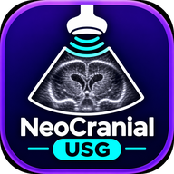

# NeoCranial USG – Neonatal Cranial Ultrasound

**Live app:** https://anncheng1.github.io/NeoCranial/

Offline-capable web app (PWA) for neonatal cranial ultrasound, built for the NICU & Special Care Nursery, Hospital Miri.

## Four components
1. **Scanning guide** – a **15-step Learn path** (prepare → depth → gain/TGC → coronal → sagittal → supplementary windows → quality rules → maturation → measurements → Doppler RI → PVE → haemorrhage grading → cysts → term HIE → documentation) with unit teaching images, quick self-checks and saved progress; plus real ultrasound images of the standard coronal C1–C6, sagittal S1–S3 and mastoid views with panel keys, plus an **image atlas** of 27 normal variants and abnormalities (GMH-IVH grades, PVHI, PVL, cerebellar haemorrhage, HIE, stroke, cysts, congenital). Tap to zoom; swipe between images. See [IMAGE_CREDITS.md](IMAGE_CREDITS.md).
2. **Findings** – structured pro forma: patient details (auto PNA / PMA), indication, technique, views obtained, brain anatomy checklist, abnormalities (GMH-IVH, PVHI, ventricular measurements, white matter injury, cerebellum, cysts, echogenicity, infarction, congenital, extra-axial, Doppler).
3. **Interpretation** – automatic classification:
   - Papile grade I–IV per side (with Volpe equivalent)
   - VI / AHW / TOD against PMA reference → normal / moderate-risk / high-risk zone (El-Dib 2020 risk-zone tool, Brouwer data)
   - Periventricular haemorrhagic infarction
   - White matter injury / cystic PVL (de Vries grade I–IV)
   - Cerebellar haemorrhage (punctate / limited / massive)
   - **PHVD monitoring** – serial VI, AHW, TOD plotted on risk-zone charts per MRN (CSV export)
4. **Report generator** – formatted A4 report (patient details → recommendation) with auto-generated, editable impression and recommendation. Print / save PDF, copy text, download .txt, save/load case (.json).

## iPhone use
- Bottom tab bar, large touch targets, no zoom-on-focus.
- **✓ Normal scan** fills a normal study in one tap; section headers show status (e.g. *Grade III*, *High risk*).
- **📷 Examples** in each findings section opens matching reference images.
- **Share** sends the report to WhatsApp, Mail, Notes, etc. **PDF / Print** uses the iOS print sheet (pinch out to save as PDF).

## Install from GitHub (GitHub Pages)
1. Create a new public repository, e.g. `NeoCranial`.
2. Upload **all files in this folder** (keep the `css/`, `js/`, `icons/` folders) to the repository root.
3. Settings → Pages → Source: *Deploy from a branch* → Branch `main`, folder `/ (root)` → Save.
4. Open `https://<username>.github.io/NeoCranial/` after ~1 minute.
5. On a phone: Share → *Add to Home Screen* (iOS) or menu → *Install app* (Android). Works offline after the first load.

To run locally without GitHub, open `index.html` in a browser (offline caching needs http/https).

## Editing thresholds
All reference values and classification text are in `js/data.js` (`REF`, `PAPILE`, `DEVRIES`, `CBH`, `GUIDE`). After changing files, bump `VERSION` in `sw.js` so installed copies update.

## Privacy
No server, no analytics. Case data, settings and PHVD series are stored only in the browser's localStorage on that device. Saved .json/.txt/PDF files contain patient identifiers – handle per hospital policy.

## Disclaimer
Clinical decision-support tool. Ventricular reference curves are digitised from published charts and are approximate; verify against source references and local protocol. Final interpretation rests with the reporting clinician.

## Key references
- James AC. Practical guide to neonatal cranial ultrasound: basics. Paediatr Child Health 2018.
- El-Dib M et al. Management of post-hemorrhagic ventricular dilatation in the infant born preterm. J Pediatr 2020;226:16-27.
- Papile LA et al. J Pediatr 1978;92:529-34.
- de Vries LS et al. Behav Brain Res 1992;49:1-6.
- Levene MI. Arch Dis Child 1981;56:900-4.
